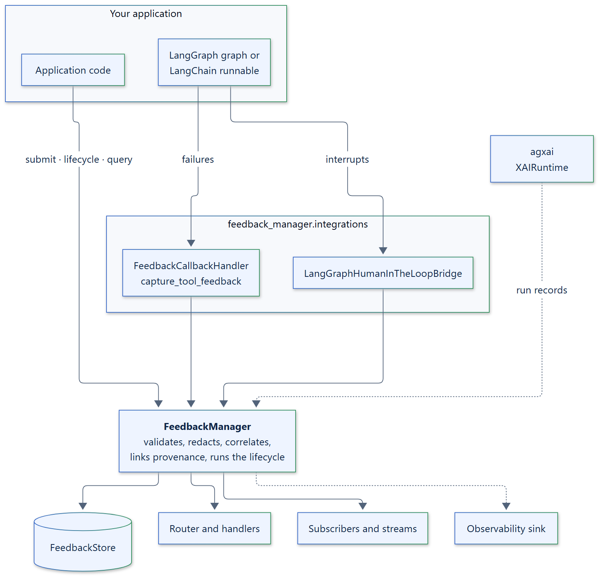

<p align="center">
  
</p>

<h1 align="center">feedback-manager</h1>

<p align="center">
  <a href="https://github.com/smuniharish/feedback-manager/actions/workflows/ci.yml"></a>
  <a href="https://feedback-manager.readthedocs.io/"></a>
  <a href="https://pypi.org/project/feedback-manager/"></a>
  <a href="https://pypi.org/project/feedback-manager/"></a>
  
  
  <a href="https://github.com/smuniharish/feedback-manager/blob/master/LICENSE"></a>
</p>

**Framework-agnostic feedback management and agent learning: capture,
correlate, store, route, resolve, and learn from feedback, for LangChain,
LangGraph, and custom agents.**

Agent applications constantly receive feedback: a reviewer approves a refund,
a user corrects an answer, a tool times out, an evaluator scores a response.
`feedback-manager` turns each of them into a validated, queryable record that
knows which run, node, tool call, or interrupt it is about, groups it with
related feedback, routes it to your handlers, and tracks it through an explicit
lifecycle until it is resolved. Your agent framework keeps owning execution;
`feedback-manager` owns the feedback about it. Framework integrations are
adapters around a framework-neutral core, so the same package works with
LangChain, LangGraph, custom Python agents, and future frameworks.

<p align="center">
  
</p>

## Features

- **One model for every kind of feedback.** Human corrections, approvals, tool
  failures, evaluator scores, and interruptions share one immutable event, with
  open sources, categories, and target types you can extend without
  subclassing.
- **Captured where it happens.** A LangChain callback handler records tool,
  model, retriever, and node failures once, with the thread, node, and tool call
  they happened in. A bridge records LangGraph human-in-the-loop requests and
  decisions around native `interrupt()` and `Command(resume=...)`.
- **An explicit, race-free lifecycle.** Feedback moves through a validated state
  machine. Transitions are compare-and-set operations on the store, so
  concurrent updates never overwrite each other. Retried calls are idempotent;
  crash recovery uses an optional durable change journal, not exactly-once delivery.
- **Linked to provenance.** With an [agxai](https://pypi.org/project/agxai/)
  runtime, feedback points at the run, node, tool call, decision, and evidence
  it is about.
- **Isolated from failures.** A failing handler, subscriber, router, or
  observability sink never loses stored feedback. Choose per stage whether a
  failure is logged or raised.
- **Bring your own infrastructure.** Swap the store, router, correlator,
  policies, and observability sink through small, typed contracts. Complete
  PostgreSQL and SQLite stores are included as examples.
- **Feedback-to-learning loop.** Automatic scoped background learning, independent
  evidence, confidence, versioned artifacts, separate human review and explicit
  activation. Disable learning with `learning=False` for feedback-only use.
- **Real optional storage.** LanceDB vectors, LadybugDB relationships and bounded,
  explainable structured/vector/graph/hybrid retrieval over authoritative artifacts.
- **Explicit recovery.** Leases, retry/backoff, dead letters and durable change-feed
  checkpoints; memory defaults remain ephemeral. A complete single-host durable
  example demonstrates recovery and private multi-agent context.

## Install

```bash
pip install feedback-manager                # core: agxai, pydantic, structlog
pip install "feedback-manager[langchain]"   # + LangChain and LangGraph adapter
```

Requires Python 3.12+. Other extras: `lancedb`, `ladybugdb`, `otel`, and `all`.

For the complete learning workflow, see
[background learning and recovery](https://feedback-manager.readthedocs.io/en/latest/how-to/background-learning/)
and [hybrid retrieval](https://feedback-manager.readthedocs.io/en/latest/how-to/hybrid-retrieval/).
From a checkout, run `uv run --all-extras python examples/15_background_learning.py`
for a synthetic, explicitly reviewed, multi-agent end-to-end example.

## Quickstart

```python
import asyncio

from feedback_manager import (
    ExecutionContext,
    FeedbackManager,
    FeedbackQuery,
    FeedbackTarget,
    FeedbackTargetType,
)


async def main() -> None:
    manager = FeedbackManager()

    # A person corrects a generated answer in conversation "support-7".
    feedback = await manager.submit(
        source="human",
        category="correction",
        target=FeedbackTarget(type=FeedbackTargetType.GENERATION, id="gen-42"),
        payload={"corrected_text": "Canberra is the capital of Australia."},
        execution_context=ExecutionContext(thread_id="support-7"),
    )
    print(f"{feedback.status}: correlated by {feedback.correlation_id}")

    # Take it through its lifecycle once the correction is applied.
    await manager.acknowledge(feedback.feedback_id)
    await manager.mark_handled(feedback.feedback_id)
    resolved = await manager.resolve(feedback.feedback_id, resolution={"applied_to": "faq"})
    print(f"{resolved.status}: {resolved.resolution}")

    # Query it back, like any other feedback.
    for event in await manager.query(FeedbackQuery(correlation_id="support-7")):
        print(event.source, event.category, event.target.id, event.status)


asyncio.run(main())
```

Output:

```text
received: correlated by support-7
resolved: {'applied_to': 'faq'}
human correction gen-42 resolved
```

Record every tool, model, and node failure of a LangChain or LangGraph agent,
without changing your error handling:

```python
from feedback_manager.integrations.frameworks.langchain import FeedbackCallbackHandler

await graph.ainvoke(inputs, {"callbacks": [FeedbackCallbackHandler(manager)]})
```

## How it relates to LangGraph, LangSmith, and agxai

LangGraph runs your agents and pauses them for human input. LangSmith and other
tracing tools show what ran. [agxai](https://pypi.org/project/agxai/)
records why it was decided. `feedback-manager` manages the feedback about all of
it: what people, evaluators, and failing components said, what it refers to,
who handles it, and how it was resolved.

## Documentation

Full documentation: **[feedback-manager.readthedocs.io](https://feedback-manager.readthedocs.io/)**

- [Quickstart](https://feedback-manager.readthedocs.io/en/latest/getting-started/quickstart/)
- [Concepts](https://feedback-manager.readthedocs.io/en/latest/concepts/)
- [How-to guides](https://feedback-manager.readthedocs.io/en/latest/how-to/)
- [Examples](https://feedback-manager.readthedocs.io/en/latest/examples/)
- [API reference](https://feedback-manager.readthedocs.io/en/latest/api/)

Changes are listed in the
[changelog](https://github.com/smuniharish/feedback-manager/blob/master/CHANGELOG.md).
Three [Agent Skills](https://feedback-manager.readthedocs.io/en/latest/agent-skills/)
teach coding agents such as Claude Code, Codex, Cursor, and GitHub Copilot to
integrate `feedback-manager`, make agents learn from feedback, and extend it
with your own components. Install them with
`npx skills add smuniharish/feedback-manager`.

## Contributing

Contributions are welcome. See
[CONTRIBUTING.md](https://github.com/smuniharish/feedback-manager/blob/master/CONTRIBUTING.md)
for the development setup and checks,
[CODE_OF_CONDUCT.md](https://github.com/smuniharish/feedback-manager/blob/master/CODE_OF_CONDUCT.md)
for community standards, and
[SECURITY.md](https://github.com/smuniharish/feedback-manager/blob/master/SECURITY.md)
to report a vulnerability.

## License

Apache License 2.0. See
[LICENSE](https://github.com/smuniharish/feedback-manager/blob/master/LICENSE).
