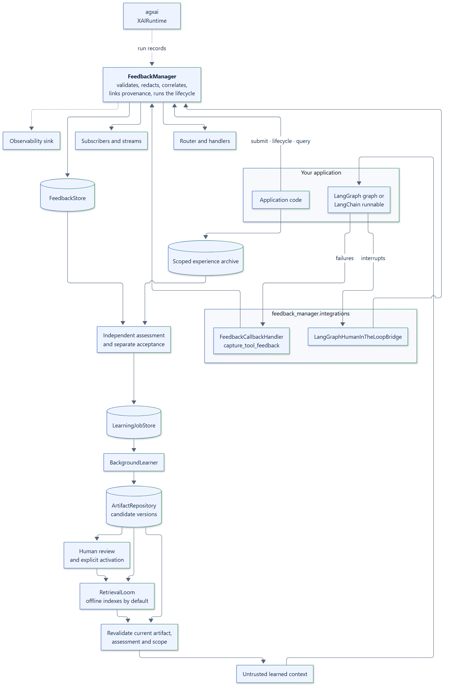

<p align="center">
  
</p>

<h1 align="center">feedback-manager</h1>

<p align="center">
  <a href="https://github.com/smuniharish/feedback-manager/actions/workflows/ci.yml"></a>
  <a href="https://feedback-manager.readthedocs.io/"></a>
  <a href="https://pypi.org/project/feedback-manager/"></a>
  <a href="https://pypi.org/project/feedback-manager/"></a>
  
  
  <a href="https://github.com/smuniharish/feedback-manager/blob/master/LICENSE"></a>
</p>

**Framework-agnostic feedback management and agent learning: capture,
correlate, store, route, resolve, and learn from feedback, for LangChain,
LangGraph, and custom agents.**

Agent applications constantly receive feedback: a reviewer approves a refund,
a user corrects an answer, a tool times out, an evaluator scores a response.
`feedback-manager` turns each of them into a validated, queryable record that
knows which run, node, tool call, or interrupt it is about, groups it with
related feedback, routes it to your handlers, and tracks it through an explicit
lifecycle until it is resolved. Your agent framework keeps owning execution;
`feedback-manager` owns the feedback about it. Framework integrations are
adapters around a framework-neutral core, so the same package works with
LangChain, LangGraph, custom Python agents, and future frameworks.

<p align="center">
  
</p>

## Why feedback-manager

A support agent drafts a refund reply. A reviewer corrects it, a tool times
out on the next run, and an evaluator scores the answer low. Today that
feedback usually ends up scattered:

- **Feedback lives in many places.** Corrections sit in a UI database, tool
  errors in logs, evaluator scores in a tracing tool, and approvals inside the
  agent framework's interrupt state.
- **It is detached from what it is about.** A score without the run, node or
  tool call it refers to can't be acted on or audited.
- **Nobody owns its follow-up.** Feedback is recorded but never acknowledged,
  handled or resolved, and concurrent workers overwrite each other's updates.
- **Agents repeat the same mistakes.** The lesson in a correction never reaches
  the next run, or it reaches it unreviewed and unscoped.

How feedback-manager addresses each one:

| Problem | What feedback-manager does |
| --- | --- |
| Feedback in many places | One immutable, typed event for corrections, approvals, tool failures, evaluator scores and interruptions, captured where they happen |
| Detached from its subject | Every event carries its target and execution context, is correlated with related feedback, and links to [agxai](https://pypi.org/project/agxai/) provenance |
| No owner for follow-up | Routing to your handlers, and an explicit lifecycle whose transitions are compare-and-set, so concurrent updates never overwrite each other |
| Repeated mistakes | A learning engine turns scoped feedback into versioned lessons that only reach an agent after human review and explicit activation |

feedback-manager doesn't run your agents or replace your tracing. Your
framework keeps owning execution, LangSmith and OpenTelemetry keep showing what
ran, and agxai records why it was decided; feedback-manager manages the
feedback about all of it.

## Highlights

- **Captured where it happens.** A LangChain callback handler records tool,
  model, retriever and node failures once, with the thread, node and tool call
  they happened in. A bridge records LangGraph human-in-the-loop requests and
  decisions around `interrupt()` and `Command(resume=...)`.
- **An explicit, race-free lifecycle.** Feedback moves through a validated state
  machine, retried submissions are idempotent, and an optional durable change
  journal supports crash recovery.
- **Learning that stays reviewable.** Automatic, scoped background learning
  builds candidate lessons with evidence and confidence. Human review and
  explicit activation are separate from feedback approval, and original
  feedback is never rewritten.
- **RetrievalLoom-backed learning.** The default learning engine uses
  RetrievalLoom's offline indexes without a model download or external vector
  database. Every hit is revalidated against the current artifact, its review
  state and its authenticated scope.
- **Isolated from failures.** A failing handler, subscriber, router or
  observability sink never loses stored feedback. Choose per stage whether a
  failure is logged or raised.
- **Extensible through native contracts.** Subclass `FrameworkAdapter` for
  Agno, CrewAI or your own loop. Configure RetrievalLoom through its native
  components and resources; agxai provenance components remain injectable.
  Deprecated legacy vector and graph retrievers remain importable for existing
  applications, and `feedback_manager.testing` checks supported implementations against
  their contracts.
- **Small and typed.** Runtime dependencies include agxai, Pydantic, RetrievalLoom
  and structlog,
  ships type hints, and is tested on Python 3.12 to 3.14 with 100% statement
  and branch coverage.

## Installation

```bash
pip install "feedback-manager[langchain]"   # with LangChain and LangGraph
pip install feedback-manager                # core only, for any other framework
```

Optional extras:

| Extra | Adds |
| --- | --- |
| `langchain` | LangChain and LangGraph capture, human-in-the-loop bridge and learned-context injection |
| `lancedb` | Legacy `LanceDBVectorStore` compatibility adapter |
| `ladybugdb` | Legacy `LadybugGraphStore` compatibility adapter |
| `otel` | `OpenTelemetryObservabilitySink` |
| `postgres` | PostgreSQL experience, assessment and payload stores for multi-process deployments |
| `all` | Every extra above |

The local-model example is source-checkout only. Run `uv sync --group models`
after placing BGE-M3 under the ignored `models/bge-m3` path; the large weights
are not installed or shipped by the package.

## Quickstart

A person corrects a generated answer. The correction is recorded against the
answer and its conversation, taken through its lifecycle and queried back:

```python
import asyncio

from feedback_manager import (
    ExecutionContext,
    FeedbackManager,
    FeedbackQuery,
    FeedbackTarget,
    FeedbackTargetType,
)


async def main() -> None:
    manager = FeedbackManager()

    # A person corrects a generated answer in conversation "support-7".
    feedback = await manager.submit(
        source="human",
        category="correction",
        target=FeedbackTarget(type=FeedbackTargetType.GENERATION, id="gen-42"),
        payload={"corrected_text": "Canberra is the capital of Australia."},
        execution_context=ExecutionContext(thread_id="support-7"),
    )
    print(f"{feedback.status}: correlated by {feedback.correlation_id}")

    # Take it through its lifecycle once the correction is applied.
    await manager.acknowledge(feedback.feedback_id)
    await manager.mark_handled(feedback.feedback_id)
    resolved = await manager.resolve(feedback.feedback_id, resolution={"applied_to": "faq"})
    print(f"{resolved.status}: {resolved.resolution}")

    # Query it back, like any other feedback.
    for event in await manager.query(FeedbackQuery(correlation_id="support-7")):
        print(event.source, event.category, event.target.id, event.status)


asyncio.run(main())
```

Output:

```text
received: correlated by support-7
resolved: {'applied_to': 'faq'}
human correction gen-42 resolved
```

Record every tool, model and node failure of a LangChain or LangGraph agent,
without changing your error handling:

```python
from feedback_manager.integrations.frameworks.langchain import FeedbackCallbackHandler

await graph.ainvoke(inputs, {"callbacks": [FeedbackCallbackHandler(manager)]})
```

The [quickstart](https://feedback-manager.readthedocs.io/en/latest/getting-started/quickstart/)
walks through it step by step.

### Learn from feedback

Feedback requires an independent assessment and a separate acceptance decision
before it can produce a candidate. A person must then review and activate the
candidate. See the [runnable example](examples/13_basic_learning.py), which
simulates those separate decisions on synthetic data. For background jobs, see
[background learning and recovery](https://feedback-manager.readthedocs.io/en/latest/how-to/background-learning/)
and [RetrievalLoom-backed retrieval](https://feedback-manager.readthedocs.io/en/latest/how-to/hybrid-retrieval/).

### Your own framework

The core never imports an agent framework. LangChain and LangGraph share one
adapter, a dependency-free adapter covers hand-written loops, and other
frameworks implement `FrameworkAdapter`. Program against the ABC and the same
agent-side code works for all of them:

```python
from feedback_manager.integrations import FrameworkAdapter


def wire(adapter: FrameworkAdapter, manager, engine):
    extractor = adapter.context_extractor()
    classifier = adapter.failure_classifier()
    bridge = adapter.human_in_the_loop(manager)
    injector = adapter.context_injector(engine)
    return extractor, classifier, bridge, injector
```

See the [custom framework guide](https://feedback-manager.readthedocs.io/en/latest/how-to/custom-agents/).

### Your own database

Feedback is kept in memory by default. Subclass `FeedbackStore` and pass it to
`FeedbackManager`; `feedback_manager.testing.FeedbackStoreContract` checks your
store against the contract:

```python
from feedback_manager import FeedbackManager
from feedback_manager.contracts import FeedbackStore


class MyStore(FeedbackStore):
    async def create(self, feedback): ...
    async def get(self, feedback_id): ...
    async def transition(self, feedback_id, status, *, expected, resolution=None): ...
    async def query(self, query): ...


manager = FeedbackManager(store=MyStore())
```

See the [SQLite store](https://feedback-manager.readthedocs.io/en/latest/how-to/custom-store/)
and [bring your own components](https://feedback-manager.readthedocs.io/en/latest/how-to/customize-components/).

## Benchmarks

The published timing table is a historical baseline from before the current
RetrievalLoom-backed search path. See
[Benchmarks](https://feedback-manager.readthedocs.io/en/latest/benchmarks/) for
its methodology and the command to reproduce measurements; do not treat the
historical retrieval numbers as current adapter performance.

## Examples

Complete programs in [`examples/`](https://github.com/smuniharish/feedback-manager/tree/master/examples),
each exercised by the test suite:

- [Human correction](https://feedback-manager.readthedocs.io/en/latest/examples/basics/#01-human-correction)
- [Human-in-the-loop approval](https://feedback-manager.readthedocs.io/en/latest/examples/basics/#02-human-in-the-loop-approval)
- [Tool failure](https://feedback-manager.readthedocs.io/en/latest/examples/basics/#03-tool-failure)
- [Provenance with agxai](https://feedback-manager.readthedocs.io/en/latest/examples/basics/#06-provenance)
- [Custom agent](https://feedback-manager.readthedocs.io/en/latest/how-to/custom-agents/)
- [Durable background learning with RetrievalLoom](https://feedback-manager.readthedocs.io/en/latest/how-to/background-learning/)
- [Local BGE-M3 with RetrievalLoom](https://feedback-manager.readthedocs.io/en/latest/how-to/hybrid-retrieval/#optional-local-bge-m3-embeddings)
- [PostgreSQL store](https://feedback-manager.readthedocs.io/en/latest/examples/production/#postgresql-store)

## Documentation

Full documentation: **[feedback-manager.readthedocs.io](https://feedback-manager.readthedocs.io/)**

- [Getting started](https://feedback-manager.readthedocs.io/en/latest/getting-started/)
- [User guide](https://feedback-manager.readthedocs.io/en/latest/guide/)
- [Examples](https://feedback-manager.readthedocs.io/en/latest/examples/)
- [API reference](https://feedback-manager.readthedocs.io/en/latest/api/)

Three [Agent Skills](https://feedback-manager.readthedocs.io/en/latest/agent-skills/)
teach coding agents such as Claude Code, Codex, Cursor and GitHub Copilot to
use feedback-manager correctly. `feedback-manager` integrates it into your
application, `feedback-manager-learning` makes agents learn from feedback, and
`feedback-manager-extend` writes adapters and stores for your infrastructure:

```bash
npx skills add smuniharish/feedback-manager
```

feedback-manager follows semantic versioning. Changes are listed in the
[changelog](https://github.com/smuniharish/feedback-manager/blob/master/CHANGELOG.md).

## Contributing

Contributions are welcome. See
[CONTRIBUTING.md](https://github.com/smuniharish/feedback-manager/blob/master/CONTRIBUTING.md)
for the development setup and checks,
[CODE_OF_CONDUCT.md](https://github.com/smuniharish/feedback-manager/blob/master/CODE_OF_CONDUCT.md)
for community standards, and
[SECURITY.md](https://github.com/smuniharish/feedback-manager/blob/master/SECURITY.md)
to report a vulnerability.

## License

Apache License 2.0. See
[LICENSE](https://github.com/smuniharish/feedback-manager/blob/master/LICENSE).
