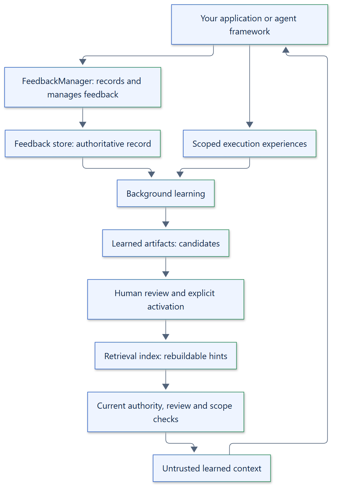

# Feedback-to-learning lifecycle

Feedback Manager learns agent-level guidance, not model weights. It is not an
agent runtime, authorization engine or fine-tuning service.

## Separate authorities

| Responsibility | Authority |
|---|---|
| Original feedback and lifecycle | `FeedbackStore` |
| Learned content, evidence, reviews and immutable versions | `ArtifactRepository` |
| Similarity search and evidence ranking | RetrievalLoom engine and its rebuildable indexes |
| Deferred learning and replay checkpoints | `LearningJobStore` |
| Execution provenance | Host records, optionally linked through agxai |

Learning never overwrites original feedback. Signals use deterministic identities;
processing the same signal again does not add duplicate evidence.

## Automatic collection, explicit publication

`FeedbackManager()` enables process-local background learning. Submission enqueues
a small job, not embedding calls or analysis. The worker starts lazily when scoped
feedback arrives. Use `async with FeedbackManager(...)` or call `aclose()` before
closing stores. Pass `learning=False` to retain feedback-only operation.
The manager closes the RetrievalLoom engine it creates; a standalone
`LearningEngine` should be closed with `await engine.aclose()`.

The default resolver uses `execution_context.tenant_id` and, when present,
`agent_id`. Missing tenant information is skipped, counted and logged; it never
becomes tenant-wide guidance by guessing a tenant. Hosts may inject a trusted
scope resolver and reprocess retained feedback after authenticating its scope.

The extractor recognizes explicit corrections, improvements, constraints, success
and failure outcomes, and human decisions. Approval and rejection signals are not
turned into new knowledge by the default artifact learners.

`LearningEngine.synthesize(signals)` can combine related signals into one review
candidate. Synthesis never widens applicability. Synthesized text is untrusted
candidate content that needs the same review and activation as any other
candidate. `ModelSynthesizer` accepts your own `SynthesisModel`; its drafts are
checked against the evidence they cite and rejected if they cite unsupported
material.

| Signal | Default artifact |
|---|---|
| Correction | Knowledge |
| Human improvement | Strategy |
| Human constraint | Constraint |
| Explicit success/failure outcome | Pattern |

## Evidence and validation

Evidence records source feedback and execution identifiers, quality, contradiction
flags and timestamps. Repeated feedback from one execution does not count as
independent support. Contradicting evidence is kept for audit. Confidence is
configurable, and older observations can be discounted.

The default validation policy requires two independent supporting observations,
sufficient confidence and an explicit human review bound to the reviewed content
digest and policy version. Scoped/type-specific configurations are supported by
`LearningValidationConfig`; overrides are host decisions, not authorization.

Artifacts move from `candidate` to `under_review`, then `validated` and `active`.
Only active, policy-eligible artifacts are returned. Rejection, deprecation and
supersession have their own lifecycle rules. New evidence returns an active
artifact to review. Invalidated evidence is retained for audit and is not restored
by replaying an older signal.

## Runtime consumption

The default `LearningEngine` delegates learned-artifact discovery to a
manager-owned RetrievalLoom engine. Its offline indexes need no model download
or external vector/graph service. Each hit is rechecked against the current
artifact repository, assessment, review policy, version and authenticated scope
before an adapter renders it as untrusted context.

Applications that need embeddings, graph traversal or durable RetrievalLoom
storage configure RetrievalLoom's native components and resources, then inject
the caller-owned engine. The older `ArtifactIndexer`, `VectorRetriever`,
`GraphRetriever` and `HybridRetriever` APIs remain compatibility facades; new
integrations should use `RetrievalLoomRetriever`.

See [background learning](../how-to/background-learning.md),
[RetrievalLoom retrieval](../how-to/hybrid-retrieval.md) and
[API reference](../api/learning.md).
