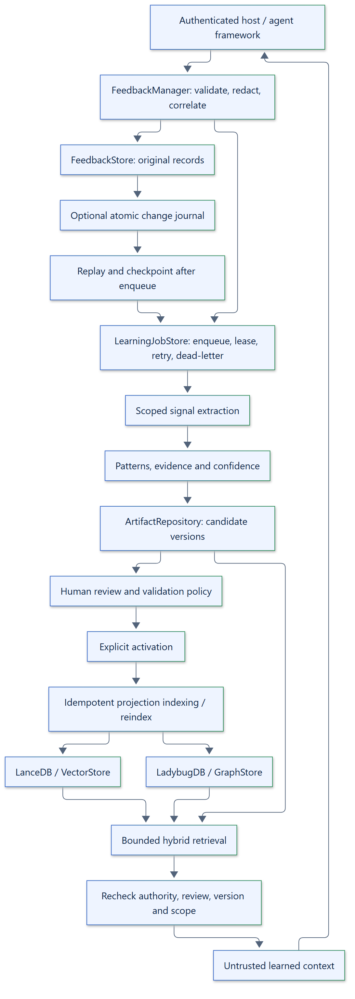

# Feedback-to-learning lifecycle

Feedback Manager learns agent-level guidance, not model weights. It is not an
agent runtime, authorization engine or fine-tuning service.

## Separate authorities

| Responsibility | Authority |
|---|---|
| Original feedback and lifecycle | `FeedbackStore` |
| Learned content, evidence, reviews and immutable versions | `ArtifactRepository` |
| Similarity search | Rebuildable `VectorStore` projections |
| Relationships and graph expansion | Rebuildable `GraphStore` projections |
| Deferred learning and replay checkpoints | `LearningJobStore` |
| Execution provenance | Host records, optionally linked through agxai |

Learning never overwrites original feedback. Signals use deterministic identities;
processing the same signal again does not add duplicate evidence.

## Automatic collection, explicit publication

`FeedbackManager()` enables process-local background learning. Submission enqueues
a small job, not embedding calls or analysis. The worker starts lazily when scoped
feedback arrives. Use `async with FeedbackManager(...)` or call `aclose()` before
closing stores. Pass `learning=False` to retain feedback-only operation.

The default resolver uses `execution_context.tenant_id` and, when present,
`agent_id`. Missing tenant information is skipped, counted and logged; it never
becomes tenant-wide guidance by guessing a tenant. Hosts may inject a trusted
scope resolver and reprocess retained feedback after authenticating its scope.

The extractor handles explicit corrections, improvements, constraints, success
and failure outcomes, and human decisions. Exact normalized patterns aggregate
incrementally; token similarity can suggest related groups without silently
merging them. Approval/rejection signals are returned as unsupported by the
default artifact learners rather than being misrepresented as new knowledge.

| Signal | Default artifact |
|---|---|
| Correction | Knowledge |
| Human improvement | Strategy |
| Human constraint | Constraint |
| Explicit success/failure outcome | Pattern |

## Evidence and validation

Evidence includes source feedback/execution identifiers, independence keys,
quality, contradiction flags and timestamps. Repeated feedback from one execution
does not become independent support. Records without an execution share an
`unverified` independence key. Confidence reports support, agreement and review
components; configurable decay can downweight old observations.

The default validation policy requires two independent supporting observations,
sufficient confidence and an explicit human review bound to the reviewed content
digest and policy version. Scoped/type-specific configurations are supported by
`LearningValidationConfig`; overrides are host decisions, not authorization.

Artifacts move from `candidate` to `under_review`, then `validated` and `active`.
Only active, policy-eligible artifacts are returned. Rejection, deprecation and
supersession have their own lifecycle rules. New evidence returns an active
artifact to review. Invalidated evidence is retained for audit and is not restored
by replaying an older signal.

## Runtime consumption

Choose structured, vector, graph or hybrid retrieval explicitly. Runtime adapters
consume the same `retrieve(RetrievalRequest)` contract. The custom adapter renders
learned guidance as delimited reference data; the LangChain family can render it
as framework messages. Neither changes the host's permissions or task rules.

See [background learning](../how-to/background-learning.md),
[hybrid retrieval](../how-to/hybrid-retrieval.md) and
[API reference](../api/learning.md).
